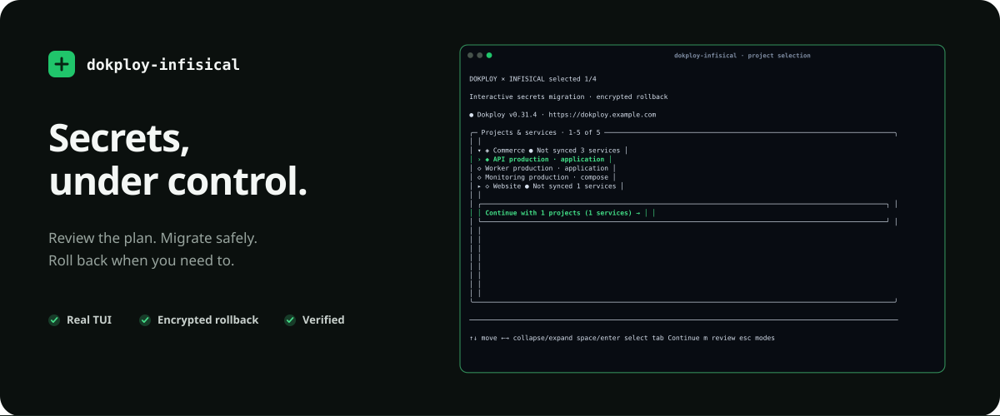
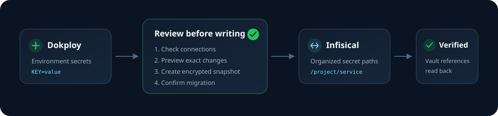
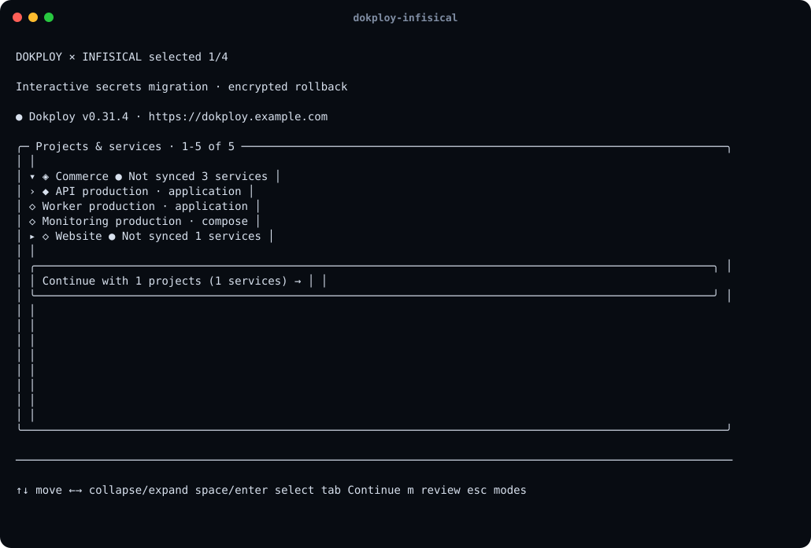

<div align="center">
  

  <br>

  [](https://github.com/sadrozzy/dokploy-infisical/actions/workflows/ci.yml)
  [](https://www.npmjs.com/package/dokploy-infisical)
  [](LICENSE)

  **English** · [Русский](README.ru.md)
</div>

## What it does

`dokploy-infisical` is a terminal app that moves application secrets from Dokploy to Infisical, then reconnects them through Dokploy Vault references.

Instead of copying values between two dashboards, you select projects, review a complete plan, and confirm the migration. Before the first change, the app creates an encrypted rollback snapshot. Afterward, it reads both systems again to verify the result.

> Community project. Not officially affiliated with Dokploy or Infisical.

### Use it when

- secrets currently live directly in Dokploy environment variables;
- Infisical is already configured as a Dokploy Vault provider;
- several projects need to move without repetitive manual work;
- you need to review every change and keep a clear recovery path.

## How it works

<p align="center">
  
</p>

Two safe workflows are available:

- **Dokploy → Infisical** — move raw values to `/<project>/_shared` or `/<project>/<service>`, then replace them in Dokploy with Vault references.
- **Infisical → Dokploy** — attach missing Vault references from the existing folder structure. Plaintext values are never copied back from Infisical.

## Quick start

### 1. Install

**Homebrew** provides a standalone binary; Node.js and Bun are not required:

```bash
brew install sadrozzy/tap/dokploy-infisical
```

Or install from the npm registry:

```bash
npm install -g dokploy-infisical
```

npm and pnpm require Node.js 26.4+. Bun installs require Bun 1.3.14+.

<details>
<summary>Other install commands</summary>

```bash
pnpm add -g dokploy-infisical
# or
bun add -g dokploy-infisical
```

</details>

macOS and Linux are supported on arm64 and x64.

### 2. Prepare access

You will need:

- a Dokploy URL and API token;
- an Infisical URL;
- Client ID and Client Secret for an Infisical Machine Identity using Universal Auth;
- an Infisical project ID and environment slug;
- the name of an existing Dokploy Vault provider.

The Vault provider must already be assigned to the projects and environments you plan to migrate.

### 3. Run

```bash
dokploy-infisical
```

On the first run, the wizard collects credentials, checks connections, and loads your projects. Then choose a workflow → select projects or services → review the plan → confirm the migration.



## Migration safeguards

| Safeguard | What it provides |
| --- | --- |
| Plan before writes | Shows secret, rewrite, conflict, and warning counts before applying anything |
| Encrypted snapshot | Created before the first change and protected with AES-256-GCM |
| Automatic rollback | Starts if a write fails |
| Read-back verification | Reads both systems again after the migration |
| Safe repeat runs | Existing `${{vault.*}}` values stay unchanged and never become plaintext |
| Separate redeploy | Never runs automatically and always requires confirmation |

The app never prints secret values to the terminal. Recovery passwords are never stored.

## Configuration and credentials

Non-secret settings are stored in:

```text
~/.config/dokploy-infisical/config.json
```

On macOS, credentials are stored in Keychain. On Linux, provide them through the environment:

```bash
export DOKPLOY_API_KEY="..."
export INFISICAL_CLIENT_ID="..."
export INFISICAL_CLIENT_SECRET="..."
dokploy-infisical
```

`DOKPLOY_AUTH_TOKEN` can be used instead of `DOKPLOY_API_KEY`.

## Rollback

Encrypted snapshots are stored in:

```text
~/.local/share/dokploy-infisical/migrations/<migration-id>.json.enc
```

Choose rollback from the main menu or run it directly:

```bash
dokploy-infisical rollback <migration-id>
```

A manual rollback restores values but does not redeploy services.

## Reference

### Commands

```text
dokploy-infisical
dokploy-infisical rollback <migration-id>
dokploy-infisical --help
dokploy-infisical --version
```

### Keyboard controls

| Keys | Action |
| --- | --- |
| `↑` / `↓`, `j` / `k` | Move |
| `←` / `→` | Collapse or expand a project |
| `space` / `enter` | Select a project or service |
| `a` | Toggle all projects |
| `tab` | Focus the Continue action |
| `m` | Open migration review |
| `esc` | Go back |
| `q` | Quit |

<details>
<summary>Complete migration sequence</summary>

1. Check the Dokploy, Infisical, and Vault provider connections.
2. Select projects or individual services.
3. Resolve Dokploy project references and build a dry plan.
4. Review secrets, rewrites, conflicts, and warnings.
5. Create an encrypted rollback snapshot.
6. Create Infisical folders and secrets.
7. Replace Dokploy values with Vault references.
8. Read both systems again and verify the result.
9. Optionally confirm redeploys as a separate action.

</details>

## Update and uninstall

| Manager | Update | Uninstall |
| --- | --- | --- |
| npm | `npm update -g dokploy-infisical` | `npm uninstall -g dokploy-infisical` |
| pnpm | `pnpm update -g dokploy-infisical` | `pnpm remove -g dokploy-infisical` |
| Bun | `bun update -g dokploy-infisical` | `bun remove -g dokploy-infisical` |
| Homebrew | `brew upgrade sadrozzy/tap/dokploy-infisical` | `brew uninstall dokploy-infisical` |

Uninstalling the app does not remove configuration, Keychain entries, or encrypted snapshots.

## Development

```bash
bun install
bun run start
```

```bash
bun run check
bun run test:runtimes
bun run test:install
bun run screenshots
```

Screenshots are generated from real OpenTUI components without secrets or production data. CI checks types, the migration engine, the TUI, both runtimes, native compilation, and packed npm installation on macOS and Linux.

See the [release checklist](docs/RELEASING.md) for publishing instructions.

## License

[MIT](LICENSE)
