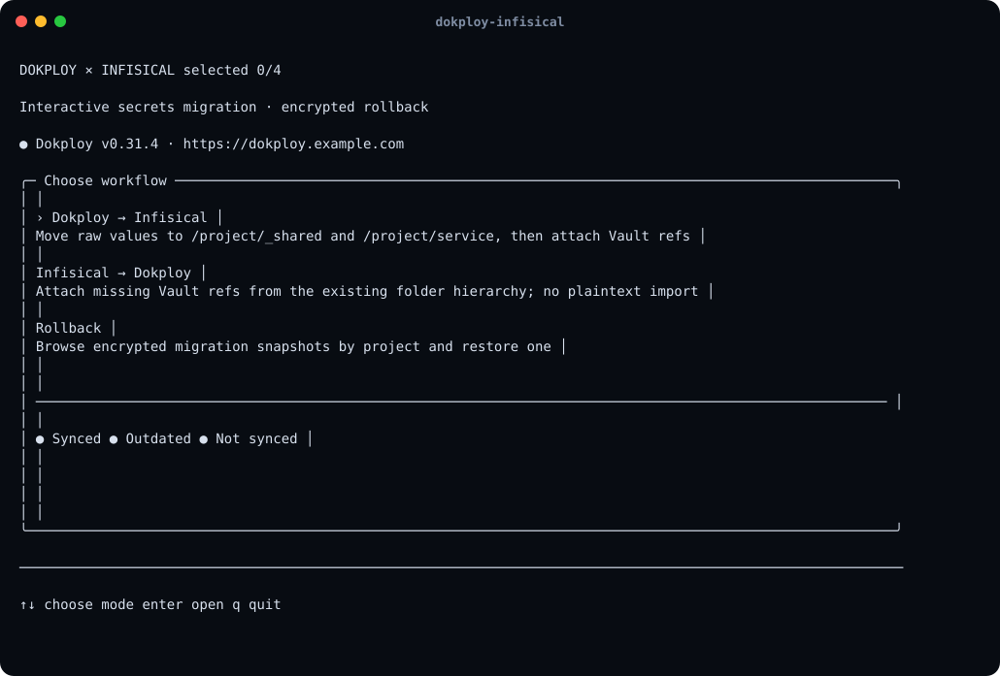
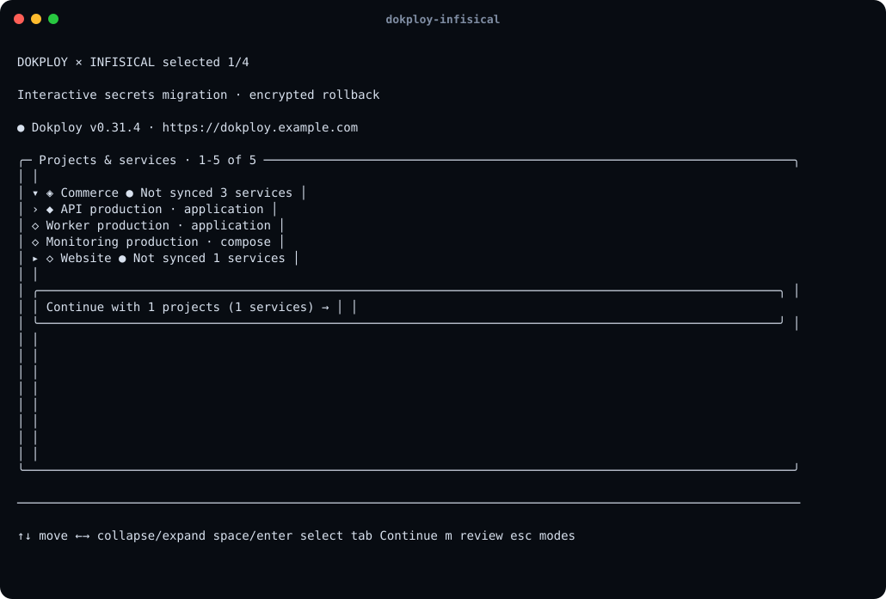

# dokploy-infisical

[](https://github.com/sadrozzy/dokploy-infisical/actions/workflows/ci.yml)
[](https://www.npmjs.com/package/dokploy-infisical)
[](LICENSE)

[English](README.md) · **Русский**

Терминальный интерфейс для безопасной синхронизации секретов окружения между Dokploy и Infisical. Приложение строит план для проверки, шифрует снимок отката до первой записи, проверяет обе системы после миграции и никогда не выводит значения секретов.

> Проект сообщества, не связанный официально с Dokploy или Infisical.

> Первый публичный релиз ещё не выполнен. Команды ниже настроены и проверяются локально и в CI, но npm-пакет и Homebrew-формула станут доступны только после ручного подтверждения и запуска релизного workflow.

## TUI

Скриншоты создаются из настоящих OpenTUI-компонентов командой `bun run screenshots`; секреты и производственные данные не используются.





## Возможности

- **Dokploy → Infisical** — перенос исходных значений в `/<project>/_shared` или `/<project>/<service>` и замена значений сервисов на Vault-ссылки.
- **Infisical → Dokploy** — добавление отсутствующих Vault-ссылок без копирования открытых значений обратно в Dokploy.
- **Зашифрованный откат** — снимки AES-256-GCM, автоматическое восстановление после ошибки записи и ручной откат из TUI или CLI.
- **Предварительная проверка** — перед применением видны точные количества секретов и замен, после него обе системы читаются повторно.
- **Безопасный повторный запуск** — существующие `${{vault.*}}` неизменяемы и никогда не копируются как открытый секрет.
- **Явный redeploy** — перезапуск подтверждается отдельно после успешной проверки и никогда не запускается автоматически.

## Установка

При любом способе установки используется одна команда: `dokploy-infisical`.

### npm

Нужен Node.js 26.4 или новее.

```bash
npm install --global dokploy-infisical
```

### pnpm

Нужен Node.js 26.4 или новее.

```bash
pnpm add --global dokploy-infisical
```

### Bun

Нужен Bun 1.3.14 или новее.

```bash
bun add --global dokploy-infisical
```

### Homebrew

Пакет Homebrew содержит автономный бинарный файл и не требует Node.js или Bun.

```bash
brew install sadrozzy/tap/dokploy-infisical
```

Поддерживаются macOS и Linux на arm64 и x64.

## Быстрый старт

```bash
dokploy-infisical
```

При первом запуске мастер запросит:

- URL и API-токен Dokploy;
- URL Infisical;
- Client ID и Client Secret для Universal Auth;
- ID проекта и slug окружения Infisical;
- имя существующего Vault-провайдера Dokploy.

Несекретные настройки сохраняются в `~/.config/dokploy-infisical/config.json`. На macOS учётные данные хранятся в Keychain. На Linux передавайте их через окружение:

```bash
export DOKPLOY_API_KEY="..."
export INFISICAL_CLIENT_ID="..."
export INFISICAL_CLIENT_SECRET="..."
dokploy-infisical
```

Токен Dokploy также можно передать как `DOKPLOY_AUTH_TOKEN`.

## Требования

- API-токен Dokploy;
- Machine Identity Infisical с Universal Auth и доступом к целевому проекту;
- существующий Vault-провайдер Dokploy, назначенный целевым проектам и окружениям;
- терминал с поддержкой TTY;
- Bun 1.3.14+ или Node.js 26.4+ для установок из npm registry. Homebrew использует автономный бинарный файл.

## Использование

```text
dokploy-infisical
dokploy-infisical rollback <migration-id>
dokploy-infisical --help
dokploy-infisical --version
```

Управление:

| Клавиши | Действие |
| --- | --- |
| `↑` / `↓`, `j` / `k` | Перемещение |
| `←` / `→` | Свернуть или раскрыть проект |
| `space` / `enter` | Выбрать проект или сервис |
| `a` | Выбрать или снять все проекты |
| `tab` | Перейти к кнопке продолжения |
| `m` | Открыть проверку миграции |
| `esc` | Вернуться назад |
| `q` | Выйти |

## Миграция и откат

Прямая миграция выполняется так:

1. Проверяются соединения с Dokploy, Infisical и Vault-провайдером.
2. Выбираются проекты или отдельные сервисы.
3. Разрешаются проектные ссылки Dokploy и строится предварительный план.
4. Проверяются секреты, замены, конфликты и предупреждения.
5. Создаётся зашифрованный снимок отката.
6. Создаются папки и секреты Infisical.
7. Значения Dokploy заменяются на Vault-ссылки.
8. Обе системы читаются повторно, результат проверяется.
9. При необходимости redeploy подтверждается отдельным действием.

Снимки хранятся здесь:

```text
~/.local/share/dokploy-infisical/migrations/<migration-id>.json.enc
```

Пароль восстановления не сохраняется. Ручной откат не перезапускает сервисы:

```bash
dokploy-infisical rollback <migration-id>
```

## Обновление и удаление

| Менеджер | Обновление | Удаление |
| --- | --- | --- |
| npm | `npm update --global dokploy-infisical` | `npm uninstall --global dokploy-infisical` |
| pnpm | `pnpm update --global dokploy-infisical` | `pnpm remove --global dokploy-infisical` |
| Bun | `bun update --global dokploy-infisical` | `bun remove --global dokploy-infisical` |
| Homebrew | `brew upgrade dokploy-infisical` | `brew uninstall dokploy-infisical` |

Удаление программы не удаляет конфигурацию, записи Keychain и зашифрованные снимки.

## Разработка

```bash
bun install
bun run start
```

Проверки и воспроизводимые скриншоты:

```bash
bun run check
bun run test:runtimes
bun run test:install
bun run screenshots
```

CI проверяет типы, движок миграции, TUI, оба runtime, нативную сборку и установку упакованного npm-архива через npm, pnpm и Bun на macOS и Linux.

## Публикация

Push и pull request никогда не публикуют пакеты. Релиз запускается вручную, сверяет версию и требует буквального подтверждения `PUBLISH`; дополнительно его можно защитить обязательным одобрением GitHub Environment. Workflow публикует npm через trusted publishing, создаёт GitHub Release с SHA-256 и обновляет `sadrozzy/homebrew-tap` с помощью токена с минимальными правами.

Перед первым релизом выполните [релизный чек-лист](docs/RELEASING.md).

## Лицензия

[MIT](LICENSE)
